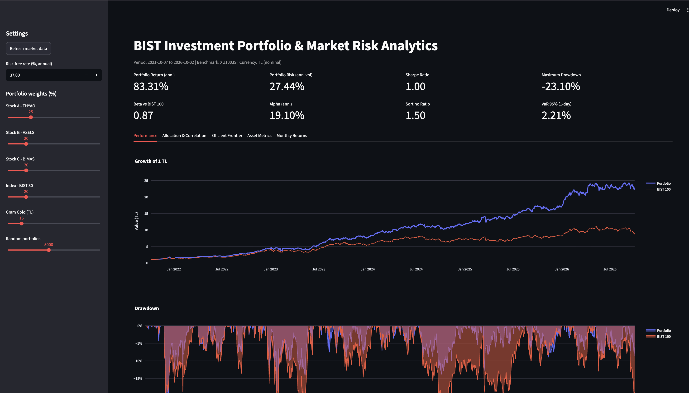
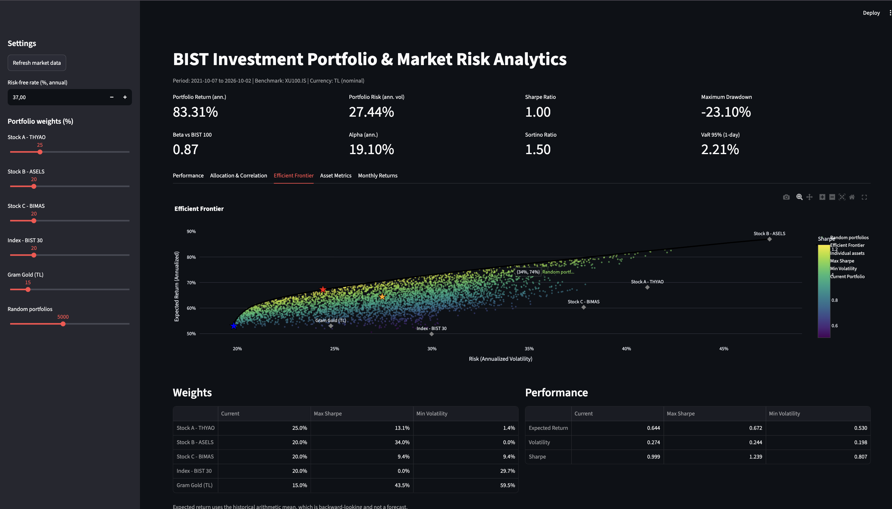
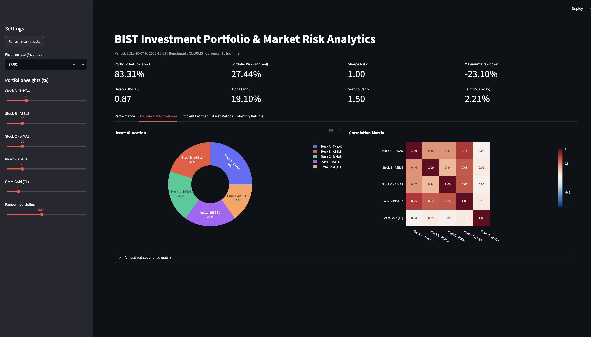

# Investment Portfolio & Market Risk Analytics (Borsa Istanbul)

An end-to-end Python project that analyzes the return, risk, volatility and drawdown of a
Borsa Istanbul (BIST) investment portfolio, applies Modern Portfolio Theory to build an
Efficient Frontier, and presents everything in an interactive Streamlit dashboard.

> 🇹🇷 Türkçe dokümantasyon için: [README_TR.md](README_TR.md)



## Features

- Daily, monthly and annualized returns
- Volatility, covariance and correlation analysis
- Beta and Alpha against the BIST 100 benchmark
- Sharpe and Sortino ratios
- Maximum Drawdown, historical VaR and CVaR (95%)
- Modern Portfolio Theory: Efficient Frontier, Max Sharpe and Min Volatility portfolios
- Interactive dashboard where weights and the risk-free rate can be changed live
- Unit tests for the core metrics

## Portfolio (default, editable in `config.yaml`)

| Asset | Ticker | Weight |
|---|---|---|
| Stock A - Turkish Airlines | THYAO.IS | 25% |
| Stock B - Aselsan | ASELS.IS | 20% |
| Stock C - BIM | BIMAS.IS | 20% |
| Index - BIST 30 (ETF proxy) | XU030.IS | 20% |
| Gram Gold in TL (defensive) | GOLD_TRY | 15% |

Benchmark: BIST 100 (`XU100.IS`). Data source: Yahoo Finance via `yfinance`.
Analysis period: 2021-10-07 to 2026-10-02 (1,300 trading days). Risk-free rate: 37%.

## Key Results

### Portfolio (current allocation)

| Metric | Value |
|---|---|
| Annualized Return (CAGR) | 83.31% |
| Annualized Volatility | 27.44% |
| Sharpe Ratio | 1.00 |
| Sortino Ratio | 1.50 |
| Maximum Drawdown | -23.10% |
| Beta vs BIST 100 | 0.87 |
| Alpha (annualized) | 19.10% |
| VaR 95% (1-day) | 2.21% |
| CVaR 95% (1-day) | 3.55% |

### Individual assets

| Asset | Return | Volatility | Sharpe | Max Drawdown | Beta |
|---|---|---|---|---|---|
| THYAO | 81.75% | 41.07% | 0.76 | -25.61% | 1.08 |
| ASELS | 113.36% | 47.35% | 1.06 | -43.53% | 1.06 |
| BIMAS | 70.16% | 37.80% | 0.62 | -33.47% | 0.85 |
| BIST 30 | 57.34% | 29.98% | 0.43 | -21.96% | 1.05 |
| Gram Gold (TL) | 64.64% | 24.80% | 0.65 | -34.42% | 0.08 |

### Optimization

| Asset | Current | Max Sharpe | Min Volatility |
|---|---|---|---|
| THYAO | 25.0% | 13.1% | 1.4% |
| ASELS | 20.0% | 34.0% | 0.0% |
| BIMAS | 20.0% | 9.4% | 9.4% |
| BIST 30 | 20.0% | 0.0% | 29.7% |
| Gram Gold | 15.0% | 43.5% | 59.5% |
| **Expected return** | - | 67.23% | 52.98% |
| **Volatility** | 27.44% | 24.39% | 19.81% |
| **Sharpe** | 1.00 | 1.24 | 0.81 |





### Findings

- **Diversification works.** The portfolio volatility (27.4%) is lower than each of the three
  stocks (38-47%) and the BIST 30 index (30.0%). Its Sharpe ratio (1.00) is higher than every
  asset except ASELS.
- **Gold is the real diversifier.** Gold has a near-zero correlation with the equities (0.04-0.10)
  and a beta of only 0.08. This is why both optimized portfolios allocate 43-60% to gold.
- **The BIST 30 index adds little.** It is highly correlated with all three stocks (0.63-0.75)
  and has the lowest Sharpe ratio (0.43). The Max Sharpe portfolio drops it entirely.
- **Defensive but not drawdown-proof.** Maximum drawdown of the portfolio is -23.1%, better than
  all three stocks and gold, and close to the BIST 30 index (-22.0%).
- **Optimization trade-offs.** Moving from the current allocation to Max Sharpe improves Sharpe
  from 1.00 to 1.24 and cuts volatility to 24.4%. The Min Volatility portfolio reaches 19.8% volatility
  but gives up return and ends up concentrated in gold.

## Project Structure

```
portfolio-risk-analytics/
├── config.yaml            # tickers, weights, risk-free rate, parameters
├── main.py                # full pipeline (terminal output + CSV exports)
├── src/
│   ├── data_loader.py     # download, cache and clean prices
│   ├── returns.py         # daily / monthly / annualized returns
│   ├── risk_metrics.py    # volatility, covariance, drawdown, VaR
│   ├── performance.py     # Sharpe, Sortino, Beta, Alpha
│   ├── portfolio.py       # portfolio-level aggregation
│   ├── optimization.py    # Markowitz optimization, efficient frontier
│   └── visualization.py   # Plotly charts
├── dashboard/app.py       # Streamlit dashboard
├── notebooks/             # exploratory analysis
├── tests/                 # unit tests
└── images/                # screenshots
```

## Installation

```bash
git clone https://github.com/elfakb/portfolio-risk-analytics.git
cd portfolio-risk-analytics
python -m venv venv
source venv/bin/activate        # Windows: venv\Scripts\activate
pip install -r requirements.txt
```

## Usage

```bash
python main.py              # run the pipeline and print results
python main.py --refresh    # force a fresh data download
streamlit run dashboard/app.py
pytest -v                   # run tests
```

## Methodology

| Metric | Definition |
|---|---|
| Annualized return | Geometric (CAGR): `(∏(1+r))^(252/n) − 1` |
| Volatility | `std(daily) × √252` |
| Sharpe | `(mean(daily) × 252 − rf) / (std(daily) × √252)` |
| Sortino | Same numerator, denominator is downside deviation |
| Beta | `Cov(asset, benchmark) / Var(benchmark)` |
| Alpha | Annualized Jensen's alpha |
| Max Drawdown | Largest peak-to-trough decline of the wealth index |
| VaR / CVaR | Historical 1-day, 95% confidence |
| Optimization | Long-only, fully invested, solved with SciPy SLSQP |

Portfolio returns assume daily rebalancing to the target weights.

## Limitations & Notes

- **All values are in nominal Turkish Lira.** Because of high inflation, nominal returns look
  large; real returns are much lower.
- **Two return conventions are used.** The reported annualized return is geometric (CAGR),
  while Sharpe, Alpha and the optimizer use the arithmetic mean × 252. With high daily returns
  in TL assets the two differ noticeably (83% CAGR vs about 64% arithmetic for the current
  portfolio), so the optimizer's expected returns should not be compared directly with CAGR.
- The default risk-free rate is **37%** (close to the CBRT policy rate). Update `risk_free_rate`
  in `config.yaml` as rates change; Sharpe ratios are very sensitive to it.
- **In-sample results.** Optimal weights use historical averages over the same period they are
  evaluated on, so they are backward-looking and **not investment advice**.
- **Selection bias.** The stocks were chosen as well-known BIST names; strong past performers
  (e.g. ASELS) inflate historical results.
- BIST ETFs on Yahoo Finance have only about one year of history, so the BIST 30 index
  (`XU030.IS`) is used as an ETF proxy. Gram gold in TL is built synthetically as
  `GC=F (USD/oz) × TRY=X ÷ 31.1035`; futures and BIST close at different times, so daily
  correlations may be slightly understated.

## Tech Stack

Python, pandas, NumPy, SciPy, yfinance, Plotly, Streamlit, pytest

